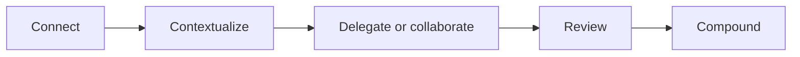

# Codex Course Map

## Module Order

0. Welcome to the Codex Course
1. What Codex Is And How To Set It Up
2. Projects, Folders, And First File Work
3. Skills As Repeatable Processes
4. Prototype A Useful Workflow
5. Goals And Longer Codex Work
6. Basics Capstone: Codex Workflow Starter Kit
7. Record A Workflow Into A Skill
8. Sites And Hosted Prototypes
9. Loops, Automations, And Safe Recurrence
10. Power-User Capstone
11. Congratulations and Next Steps

## Learning Outcomes

By the end of the course, the learner should be able to:

- explain what Codex is and when to use it
- customize Codex settings and preferences for a non-technical learning experience
- understand projects as local folders with context
- understand what is inside this course folder and where to inspect it
- inspect before editing and make one small safe file change
- inspect and run a local example skill
- create one use-case shortlist
- build one first practical skill
- build one custom workflow skill
- build one local prototype dashboard or app
- draft one bounded, evidence-based Goal using the official Goal structure
- assemble one Codex Workflow Starter Kit from a real professional pain point
- know when a real project deserves its own local folder
- prepare one recorded workflow skill or recording plan
- deploy one Codex Sites URL
- schedule one safe recurring loop
- map one practical Codex workflow system
- refine those artifacts for a real workflow

## Course Spine

The course repeats one practical loop:

Learners should leave each module with either a small artifact, a clear decision, or a reusable habit.

## Shared Support Files

- `reference/cheat-sheet.md`
- `reference/codex-best-practices.md`
- `reference/glossary.md`
- `reference/troubleshooting.md`
- `reference/how-to-use-this-course.md`
- `learner-assets/artifact-tracker.md`
- `learner-assets/use-case-shortlist.md`
