# Course Map

Take the foundation in ChatGPT Work or Codex. We recommend one weekly team update as the example that connects the modules. You may choose another task; carry that same choice through the course.

After connecting tools in Lesson 1.04, use Lesson 1.05 to find ideas from your calendar, Granola notes, and Linear project activity. Then continue with your chosen workflow.

See [the team-update example](../reference/team-update-example.md) for the exact inputs and handoffs.

```mermaid
flowchart LR
  A[Choose Work or Codex] --> A2[Connect tools and find ideas]
  A2 --> B[Project and first team update]
  B --> C[Use Clean Draft]
  C --> D[Build the team-update skill]
  D --> E[Record and replay a task]
  E --> F[Schedule useful work]
  F --> G[Review and save a Page]
  G --> H[Choose useful work files]
  H --> I[Build a team Site]
```

The diagram shows the learning sequence, not automatic integrations. You test each handoff.

| Module | Path |
| --- | --- |
| [1. Get Started in Work or Codex](../curriculum/modules/module-01-start-here/MODULE.md) | Shared foundation |
| [2. Give Your Workflow a Home](../curriculum/modules/module-02-projects-and-first-update/MODULE.md) | Shared foundation |
| [3. Use Clean Draft, Then Build Your First Skill](../curriculum/modules/module-03-skills/MODULE.md) | Shared foundation |
| [4. Record a Workflow and Reuse It](../curriculum/modules/module-04-record-a-workflow/MODULE.md) | Shared foundation |
| [5. Put a Useful Skill on a Schedule](../curriculum/modules/module-05-scheduled-tasks/MODULE.md) | Shared foundation |
| [6. Create and Improve Work in Space](../curriculum/modules/module-06-space-and-pages/MODULE.md) | Shared foundation |
| [7. Create Work Your Audience Can Use](../curriculum/modules/module-07-documents-slides-and-spreadsheets/MODULE.md) | Shared foundation |
| [8. Build a Useful Team Site](../curriculum/modules/module-08-sites-and-foundation-checkpoint/MODULE.md) | Shared foundation |
| [9. Build Further with Codex](../curriculum/modules/module-09-local-prototype-extension/MODULE.md) | Codex technical path |
| [10. Guide Longer Work in Work or Codex](../curriculum/modules/module-10-longer-work-and-system-map/MODULE.md) | Work and Codex longer-work path |

## Your Learning Rhythm

Learn a concept, see a concrete example, and make something with the tutor. Optional challenges let you practice independently. Success means a result you can open, use, and verify.

## Choose Your Next Step

After Module 8, take the [closing lesson](modules/module-11-closing/closing.md), choose the Codex building path, or explore longer work in your current surface.

The tutor uses `course-index.json` for current lesson titles and saves your position in `learner-assets/progress.json` when writable files are available.
