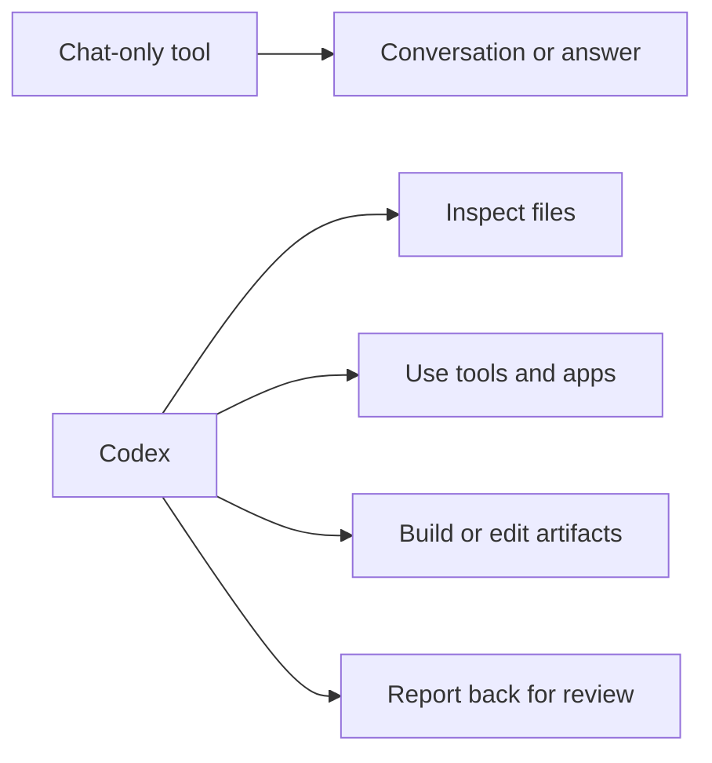

# Lesson 1.02: Codex vs Chat Tools

## Where You Are

You now have the key mental model: Codex can act inside a workspace. This lesson helps you decide when that matters.

## Learn

Chat-only AI is great when you mostly need conversation: ideas, drafting, quick explanations, and general help.

Codex is the better fit when you want an agent to work with actual context: folders, files, tools, apps, web/browser access where allowed, prototypes, skills, or changed artifacts.

This lesson is not about memorizing product differences. It is about building judgment. If you mostly want a conversation, chat is often enough. If you want to inspect a workspace, edit files, build a prototype, create a skill, or review changes, Codex is usually the better starting point.

## Visual Cue



## Practice

Try this in Codex:

```text
Compare Codex with a chat-only AI tool for a beginner. Keep it practical. Give me 5 examples where chat is enough and 5 examples where Codex is a better fit because files, folders, tools, apps, or artifacts matter.
```

**Success criteria:** The response stays practical and leaves the learner with a clear sense of when Codex is the right starting point.

## What You Made Or Decided

You now have a simple decision rule: use chat for conversation, and use Codex when context and action matter.

## What's On Deck

Next, you will run a safe read-only task so Codex can show you what it sees before it changes anything.
