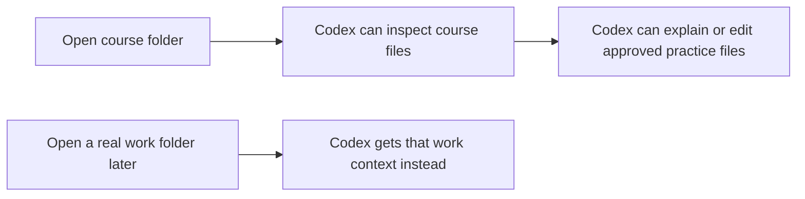

# Lesson 2.01: What A Codex Project Is

## Where You Are

You finished the first course-folder tour. Now you will learn the project mental model that explains why that folder matters.

## Learn

A Codex project is basically a local folder Codex can work inside. The project gives Codex context: files, folders, notes, drafts, instructions, and other materials stored there.

You do not always need a project. If you are asking a general question, brainstorming, or drafting something from scratch, a plain conversation may be enough. But when you want Codex to inspect files, edit files, build a skill, or prototype something, the project matters.

Beginner mental model: **the project is the box Codex can look inside and work inside.** For this course, the box is the course folder you opened.

## Video Cue

Watch this optional walkthrough: [Codex and local files](https://www.loom.com/share/a484c698046f467bb9e2906bf4f5a8cf).

Note: this video was recorded before major updates to the Codex desktop app, so it shows Codex in the terminal. The same core concept still applies in the desktop app: when you open a local folder as a Codex project, you are giving Codex access to that folder's context and, when you approve changes, the ability to edit local files.

## Visual Cue



## Practice

Try this in Codex:

```text
Explain what a Codex project is using this course folder as the example. Tell me what Codex can see in this project, why that context helps, and when I might use Codex without opening a specific project or folder.
```

**Success criteria:** The learner can explain that a Codex project is a folder of local context and that some conversations do not require project files.

## What You Made Or Decided

You now know that the course project is the local folder that gives Codex the course context.

## What's On Deck

Next, you will learn which folders inside this course are for lessons, practice, reference, and experimentation.
