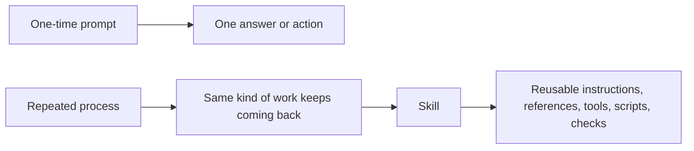

# Lesson 3.01: Prompts vs Repeatable Workflows vs Skills

## Where You Are

You have made and reviewed real file changes. Now you will learn how repeated work can become a reusable Codex process.

## Learn

A prompt is a one-time instruction. A repeatable process is a task you do in a similar way again and again. A skill is a reusable process Codex can follow for one kind of work.

This is where a skill is different from the mental model many people have for a custom GPT. A custom GPT often chats back in a configured way. A Codex skill can encapsulate a whole process. It may include instructions, references, examples, scripts, and tool steps that make regular work easier.

The key beginner idea is simple: if you keep asking Codex to do the same kind of work, a skill may be the right next step.

This course uses "workflow automation" in a beginner sense here: making repeated work easier and more consistent through skills. Scheduled automations come later in Module 9.

## Visual Cue



## Practice

Try this in Codex:

```text
Explain the difference between a one-time prompt, a repeatable process, and a Codex skill. Use my weekly recap work from Module 2 as the example. Compare a skill with a custom GPT in plain language, and tell me when a repeated prompt is worth turning into a skill.
```

**Success criteria:** The learner can explain why a repeated task might become a skill and understands that scheduled automations are a later topic.

## What You Made Or Decided

You now understand a skill as a reusable process, not just a saved prompt.

## What's On Deck

Next, you will clarify where skill learning happens during this course.
