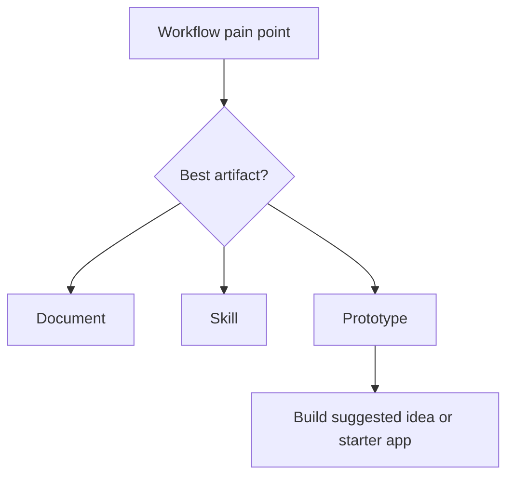

# Lesson 4.01: Choose A Prototype Path

## Where You Are

You have built or inspected skills as reusable processes. Now you will decide whether one of your pain points would be easier to understand as a small app, dashboard, tracker, or review surface.

## Learn

A prototype is a small working version of an idea. It helps you see and test a workflow instead of only describing it.

A skill is best when you want Codex to follow reusable instructions. A document is best when you need written output. A prototype is best when a small interface, dashboard, tracker, or tool would make the workflow easier to understand or use.

The first prototype should be small. The goal is not a perfect app. The goal is something you can inspect, preview, and improve.

This lesson should not hand you an idea and then abandon it. Codex should use your use-case shortlist or Module 3 workflow interview to suggest one useful prototype, then ask whether you want to build that prototype or use the starter app.

## Video Cue

Watch this walkthrough: [Prototyping in Codex](https://www.loom.com/share/d6b623e6bc2e416c89fd0e877f65171f).

## Visual Cue



## Practice

Try this in Codex:

```text
Use my Module 3 workflow summary or `learner-assets/use-case-shortlist.md` to suggest 2 or 3 small prototype ideas that could solve a real professional pain point. Compare when each idea should be a document, a skill, or a small app. Recommend one small prototype, then ask me whether I want to build that suggested prototype or use the starter app path.
```

**Success criteria:** The learner can explain why a prototype is different from a document or skill and has one small prototype candidate.

## What You Made Or Decided

You chose a prototype path: your suggested pain-point prototype or the safer starter app path.

## What's On Deck

Next, you will tour the starter app so you understand the basic pieces even if you build your own idea later.
