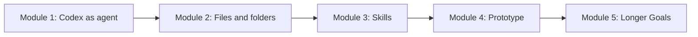

# Lesson 4.07: Checkpoint Before Goals

## Where You Are

You have completed the main beginner build arc: files, skills, and a prototype. Before longer-horizon Goals, pause and look at what you now know.

## Learn

This checkpoint is here because the course has moved quickly. You have learned several different Codex surfaces:

- normal prompts for one clear request
- files and folders for local context
- skills for repeatable processes
- prototypes for visual or interactive workflow surfaces
- review habits for staying in control

It is normal if some of it still feels fuzzy. The goal is not memorizing every feature. The goal is knowing what Codex can help with and how to ask it to slow down when needed.

## Visual Cue



## Practice

Try this in Codex:

```text
Give me a visual checkpoint before Module 5. Summarize what I have learned so far across Modules 1-4, what artifacts I should now have, and what still might feel confusing. Then ask me how I am feeling: confident, mixed, or lost. Based on my answer, recommend whether I should continue to Goals, review one concept, or recap my artifacts first.
```

**Success criteria:** The learner sees what they have learned, checks in with how they feel, and has a clear next step.

## What You Made Or Decided

You paused, reviewed the foundation, and decided whether you are ready for Goals.

## What's On Deck

Next, Module 5 introduces Codex Goals for longer, evidence-checked work.
