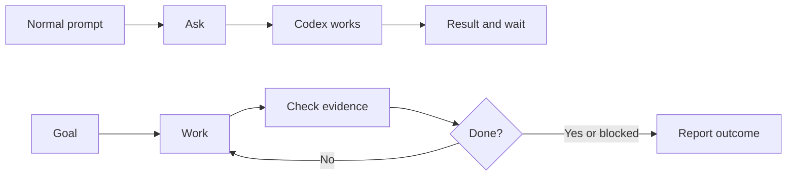

# Lesson 5.01: Normal Prompt vs Goal

## Where You Are

You just finished files, skills, and a prototype. Goals are different: they are for longer work where Codex may need to keep going.

## Learn

A normal prompt asks Codex for the next useful step: inspect this file, make this change, summarize this folder, or help me plan.

A Goal gives Codex a persistent objective to work toward across a longer task. Use it when the path may take several steps, the next step depends on what Codex learns, and the finish line can be checked with evidence.

Goal mode is not for everything. If the task is quick, vague, or impossible to verify, use a normal prompt instead.

Good Goal candidates include long audits, competitive market analysis, clearing or organizing a large inbox with review rules, complex evidence-backed research, and work where you would otherwise keep saying "keep going" after every step.

Bad Goal candidates include one-line edits, quick explanations, vague requests like "make this better," or work where no evidence can prove completion.

## Visual Cue



## Practice

Try this in Codex:

```text
Teach me the difference between a normal prompt and a Codex Goal using one workflow from this course. Give me 3 examples where a normal prompt is enough and 3 examples where a Goal would be better, including a long audit, a competitive market analysis, and a large inbox cleanup or review queue.
```

**Success criteria:** The learner can explain when a normal prompt is enough and when a Goal is worth using.

## What You Made Or Decided

You learned that Goals are for longer, evidence-checked work, not for every task.

## What's On Deck

Next, you will learn the parts of a strong Goal.
