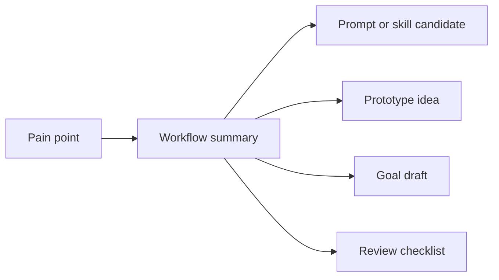

# Lesson 6.01: Choose One Capstone Pain Point

## Where You Are

You have completed the beginner building blocks: file work, skills, prototypes, and a Goal draft. Now you will choose one professional pain point to pull them together.

## Learn

The capstone is not a project-switching drill. It is a practical bundle for one workflow you might actually improve.

Choose a pain point that is:

- real enough to matter
- small enough to describe
- repeated enough that a reusable process could help
- reviewable enough that you can tell whether Codex did good work

Use `learner-assets/use-case-shortlist.md`, your Module 3 workflow interview, or your Module 4 prototype idea as the source.

## Visual Cue



## Practice

Try this in Codex:

```text
Help me choose one professional pain point for my Module 6 capstone. Use my `learner-assets/use-case-shortlist.md`, Module 3 workflow summary, and Module 4 prototype work if available. Compare 2 or 3 options and recommend the one that is real, repeated, small enough to describe, and easy enough to review. End with a one-paragraph pain point summary.
```

**Success criteria:** The learner chooses one pain point that can anchor the starter kit.

## What You Made Or Decided

You chose the pain point for your Codex Workflow Starter Kit.

## What's On Deck

Next, you will assemble the starter kit pieces around that pain point.
